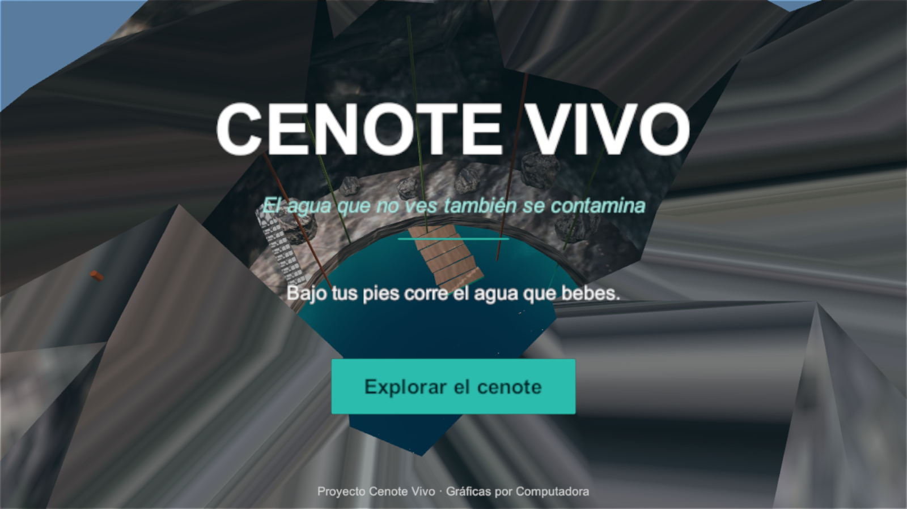
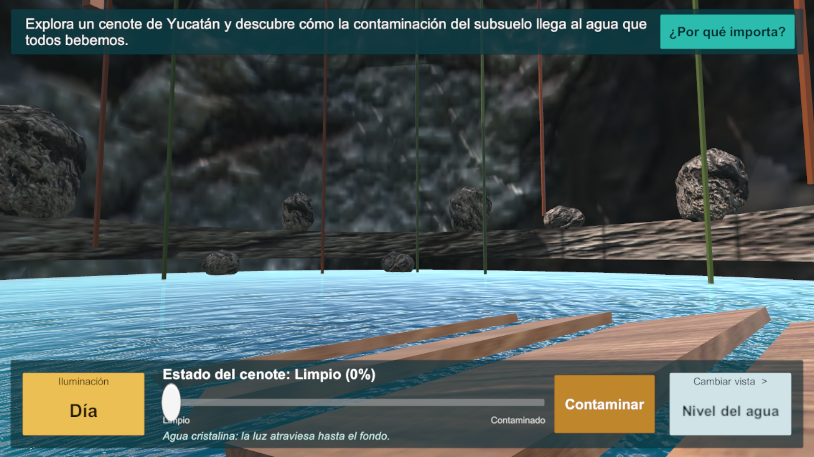
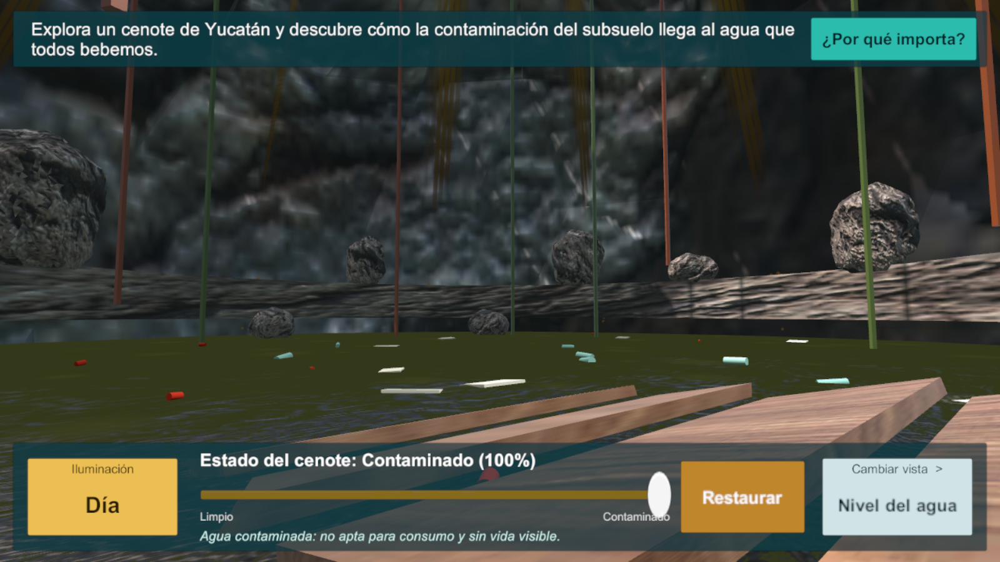
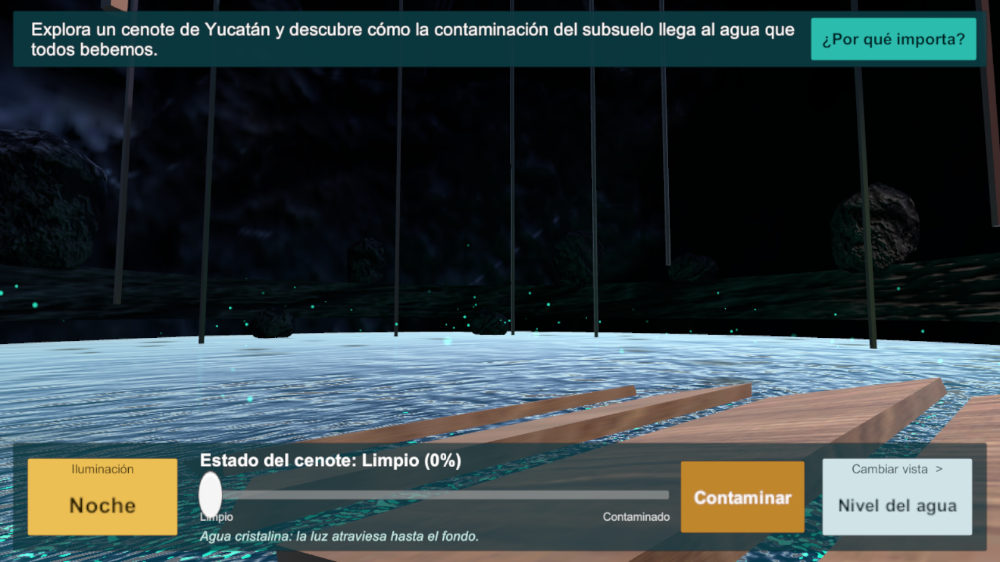
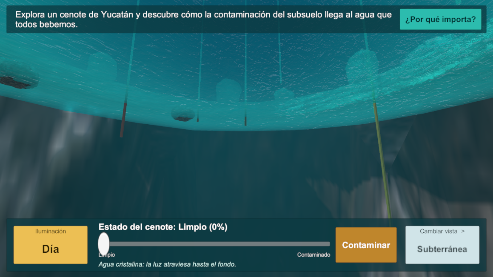
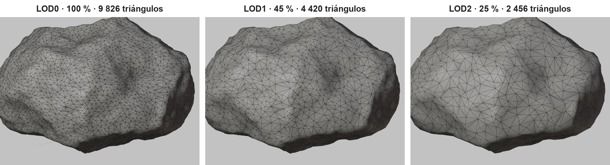

# Cenote Vivo

Aplicación móvil 3D para Android (Unity 6 · URP) que muestra cómo la contaminación del subsuelo llega al agua subterránea de los cenotes de Yucatán.

## Funciones
- **Simulador de contaminación:** un slider lleva el agua de cristalina a turbia; aparecen filtraciones en la roca, lixiviados y basura flotante.
- **Día / Noche:** transición de luz; de noche aparece bioluminiscencia que desaparece si el agua está contaminada.
- **3 vistas de cámara:** panorámica, nivel del agua y subterránea.
- **Panel informativo** sobre filtración de residuos, pérdida de biodiversidad y riesgos para el consumo humano.

| Limpio | Contaminado |
|---|---|
|  |  |
|  |  |

## Técnico
- Shader de agua propio (`Assets/CenoteVivo/Shaders/CenoteWater.shader`): profundidad, refracción, Fresnel y `_PollutionLevel`.
- Rocas con Decimate en Blender y LOD Group (9 826 / 4 420 / 2 456 triángulos).
- Static batching, SRP Batcher, texturas ASTC, MSAA 4x.

## Uso
Abrir con Unity 6000.5.7f1 → menú **Cenote Vivo → Abrir escena**. APK: **Cenote Vivo → Compilar APK (Android)**. Más detalles en `CENOTE_VIVO_README.md`.

Autor: Diego Mora Márquez · Universidad Marista de Mérida
